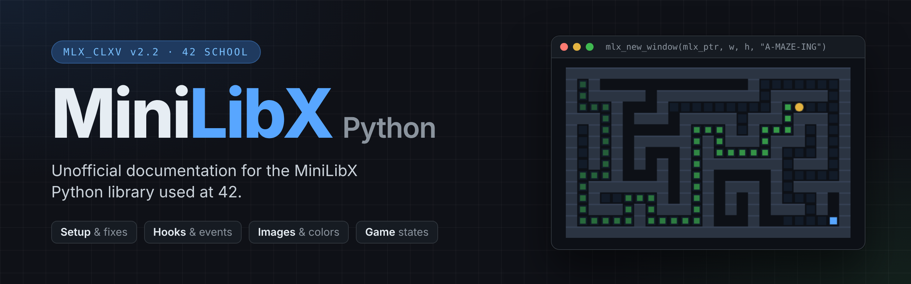

  
  
  

 

<h1>MinilibX (MLX) Helpful Documentation (Python Edition)</h1>

A complete practical guide for using MinilibX (MLX) in Python projects at 42 School.

  

 

---

## 📚 About

This project was created to help students understand and use the MiniLibX library with Python.

Unlike the C version of MLX, the Python adaptation has very little documentation available online, making it difficult to learn, debug, and structure graphical projects properly.

This repository gathers notes, examples, experiments, and practical explanations created while developing the A-Maze-ing project at 42 School.

The goal is to make future MLX Python projects easier to build and understand.

--- 

## 🗂️ Documentation

New to MLX? Read them in this order:

| # | Guide | What's inside | PDF |
| --- | --- | --- | --- |
| 1 | [Setup & Troubleshooting](guides/setup-and-troubleshooting.md) | Dependencies, building and installing MLX, WSL, common errors and fixes | [PDF](guides/pdf_version/setup-and-troubleshooting.pdf) |
| 2 | [MLX Reference](guides/mlx-reference.md) | Every function: windows, images, hooks, colors, sync, recipes, quick reference card | [PDF](guides/pdf_version/mlx-reference.pdf) |
| 3 | [Coordinate Systems](guides/coordinate-systems.md) | Grid vs. pixel coordinates, tile size, centering, mouse → tile | [PDF](guides/pdf_version//coordinate-systems.pdf) |
| 4 | [Game States & Menus](guides/game-states-and-menus.md) | One window with many screens, menu navigation, themes, common problems | [PDF](guides/pdf_version/game-states-and-menus.pdf) |

---

## 📖 Additional Documentation

For more complete project documentation and additional MLX usage examples, you can also check the `guides/` folder from the A-Maze-ing project repository:
https://github.com/SaraFreitas-dev/A-Maze-ing

---

## 👩‍💻 Authors

🦆 Sara Freitas  
🎮 Bruno Ramalho

Created during the development of the [**A-Maze-ing**](https://github.com/SaraFreitas-dev/A-Maze-ing) project at **42 Porto**.

---

## 🎯 Purpose

This documentation is not official MLX documentation.

It is a practical and beginner-friendly guide made from real project experience, focused mainly on:

- learning by testing
- solving common MLX problems
- helping other 42 students
- keeping useful examples for future projects

Everything here refers to **mlx_CLXV v2.2** (Linux / XCB / Vulkan). Found a mistake or something missing? Issues and pull requests are welcome.
